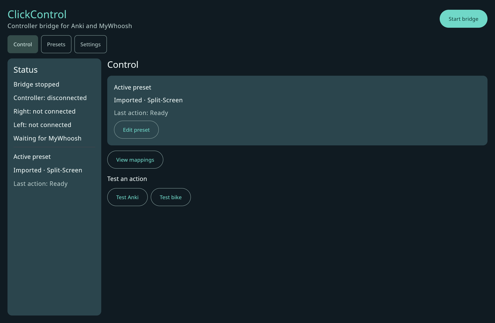
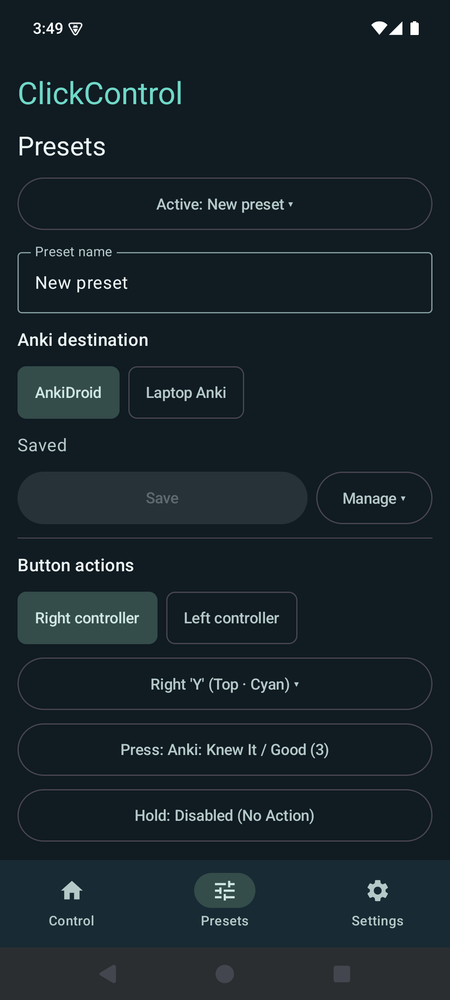

# ClickControl

ClickControl routes Zwift Click controller buttons to Anki and MyWhoosh. It has an Android app and a desktop app. Android requires Android 10 (API 29) or later; desktop packages are configured for Linux, macOS and Windows. Local validation described in [AUDIT.md](AUDIT.md) covers Linux and an Android emulator; real controllers and target apps still need testing.

## Quick start

1. Install a package from the [GitHub releases](https://github.com/thies2005/AnkiMywhooshControl/releases), or [build from source](docs/DEVELOPMENT.md). Enable Bluetooth and wake the controllers.
2. For a laptop running Anki, install and enable AnkiConnect. On the same laptop, use `127.0.0.1:8765` in ClickControl. For Android connecting to laptop Anki, select **Laptop Anki** in the preset, enter the laptop's private LAN IPv4 address and port, and configure AnkiConnect and the firewall to accept that trusted LAN connection. AnkiConnect's default loopback binding is local only.
3. In **Settings**, choose **Right controller only** on the device running ClickControl. Connect the left controller to the cycling app separately. An unidentified controller is not assumed to be right: pin its verified Bluetooth address if necessary. A controller should have only one Bluetooth owner.
4. In **Presets**, select a mapping, then use **Control** to connect. Standard right-side presses flip or grade cards (Y Again, Z Hard, A/B Good; holds include Undo and Easy). The first grading press reveals the answer; a subsequent press grades it.

To route both controllers through ClickControl, choose **Both controllers** in Settings and use a preset with right-side Anki and left-side bike actions. Standard bindings provide shifting, steering, camera and emote actions. MyWhoosh must connect to the advertised OpenBikeControl service for network control; platform-specific fallback options are described in [setup](docs/SETUP.md).

**Presets** contains named mappings for press and hold actions. Create a blank or standard preset, duplicate, rename, edit, save, reset or delete it. Save a draft before switching, or explicitly discard it. Existing per-mode mappings migrate into editable Imported presets. Controller ownership is a separate Settings choice and changing a binding does not change which pod is connected. Android presets also choose AnkiDroid or laptop Anki as their Anki destination.

For installation and connection details see [Setup](docs/SETUP.md); for builds, tests and architecture see [Development](docs/DEVELOPMENT.md); for common problems see [Troubleshooting](docs/TROUBLESHOOTING.md). The [documentation index](docs/README.md) links to design and audit notes.

## Interface

| Desktop Control | Android preset editor |
| --- | --- |
|  |  |
